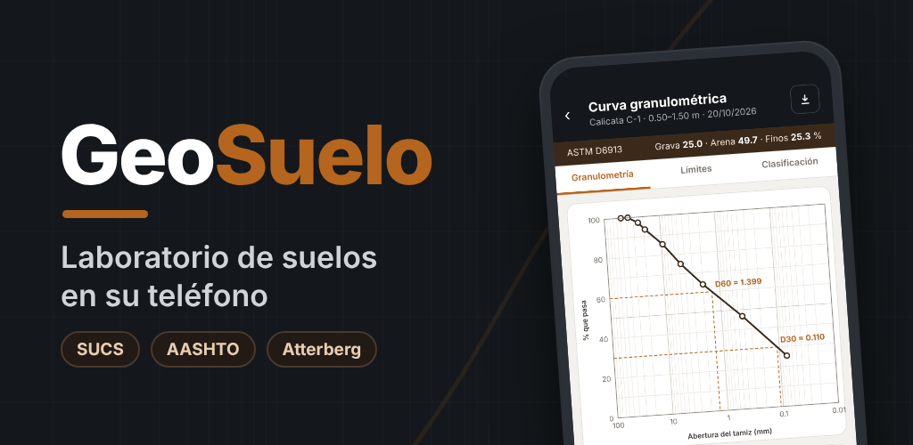
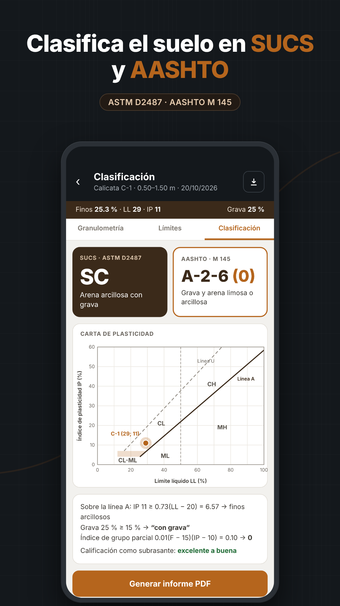
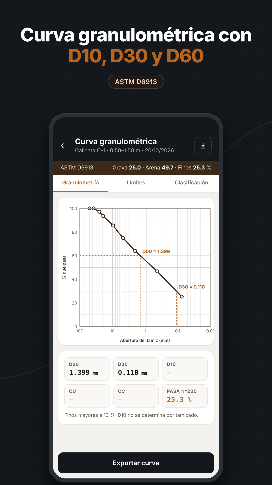
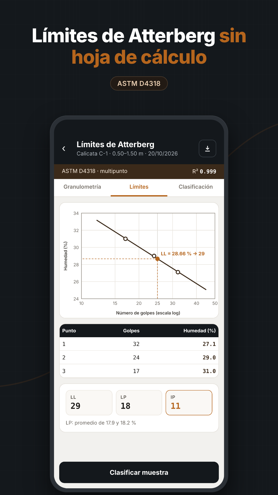
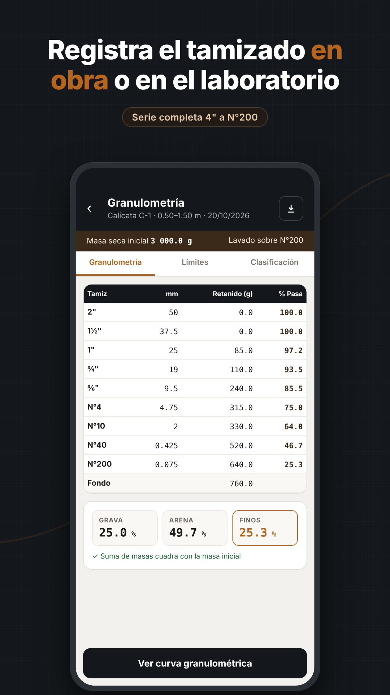
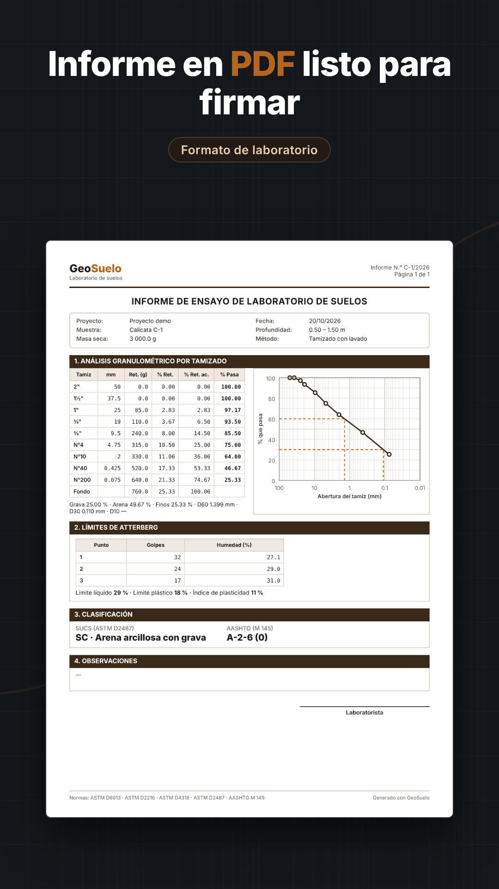

# GeoSuelo

Laboratorio de suelos en su teléfono. Granulometría por tamizado, límites de Atterberg, clasificación SUCS y AASHTO, curva granulométrica e informe en PDF. Funciona sin internet; los datos se guardan solo en el teléfono.

| | | |
|---|---|---|
|  |  |  |
|  |  | |

## Normas de referencia
ASTM D6913 · ASTM D2216 · ASTM D4318 · ASTM D2487 · AASHTO M 145

## Descarga
Página de descarga: https://jluismp2023.github.io/geosuelo-descargas/
